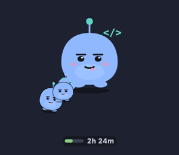
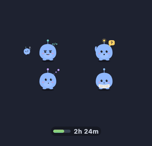
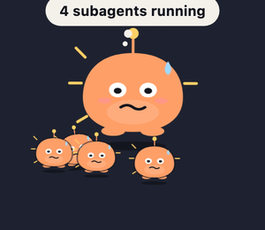
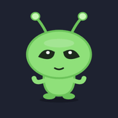
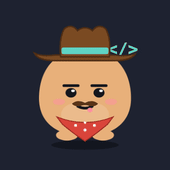

<div align="center">

# claude-pet

**A tiny creature that lives on your Mac and shows what Claude Code is doing — right now.**



[](https://github.com/r45635/claude-pet/releases/latest)

[](https://github.com/r45635/claude-pet-avatars)
[](LICENSE)

</div>

Claude Code works in the background; you work in front. **claude-pet sits in a corner of
your screen and tells you, at a glance, what Claude is up to**: thinking, reading,
coding, running tools, storming through a big task — or **waiting for you**. No more
switching windows to check whether it's done, stuck, or asking you something.

```bash
brew install r45635/tap/claude-pet
claude-pet setup
```

<sub>No Homebrew? `curl -fsSLO https://github.com/r45635/claude-pet/releases/latest/download/claude-pet-aarch64-apple-darwin.tar.gz && tar -xzf claude-pet-aarch64-apple-darwin.tar.gz && ./claude-pet/claude-pet setup`</sub>

That's it. Open Claude Code — in a terminal or in VS Code — and the creature wakes up.

▶ **[Watch the 30-second demo](docs/media/demo-wide.mp4)**

---

## It shows what's really happening

Every look comes from what Claude Code actually reports — its hooks, its status line, the
network of its own process. Never an invented mood.

|  |  |  |  |
|:---:|:---:|:---:|:---:|
| **asleep** | **thinking** | **reading** | **coding** |
|  |  |  |  |
| **running a tool** | **waiting for you** | **done** | **in trouble** |

## Subagents, sessions, storms

<table>
<tr>
<td width="50%" align="center"></td>
<td width="50%" align="center"></td>
</tr>
<tr>
<td><b>Every session gets its own creature</b>, every subagent a little one walking around
its parent. Four windows of Claude Code? Four families — and the one waiting for you raises
its hand.</td>
<td><b>When things heat up, it storms</b> — and a bubble says why: <i>42 tool calls/min</i>,
<i>4 subagents running</i>, <i>Bash failed</i>, <i>Rate limited</i>.</td>
</tr>
</table>

## It gets tired, too


As a session's **context window fills up**, its creature starts to sweat, then wears out —
a quiet hint that it's time to `/compact` or start fresh.

Under the feet, a small gauge shows **how much of your plan's 5-hour window** you have used,
and when it resets.

<br clear="right">

## Make it yours — the avatar library

<p align="center">






</p>

Ghosts, aliens, a cowboy whose hat follows the mood, seasonal looks… Browse the
**[claude-pet avatar library →](https://github.com/r45635/claude-pet-avatars)** and install
one from the creature's menu (right-click → **Avatar ▸ Library**) or in one line:

```bash
~/.claude-pet/app/claude-pet avatars install ghost
```

Every avatar is signed and checked before it installs.

> **🎨 Designers wanted.** A robot, a cat, a dragon, pixel art, your team's mascot? One picture
> is already an avatar — every Claude Code user can then pick yours from the menu.
> [How to make one](https://github.com/r45635/claude-pet-avatars/blob/main/CONTRIBUTING.md) ·
> [ideas waiting for a designer](https://github.com/r45635/claude-pet-avatars/issues?q=is%3Aopen+label%3A%22good+first+avatar%22)

## On your desktop, or in the menu bar

Prefer a clean desktop? Right-click → **Display** → *In the menu bar*. The icon's title is
the state at a glance — 💭 📖 ⌨️ 🔧 ⚡ ✋ ✅ ❗ — and its menu is the creature's. Or keep both.

From the same menu, **Sessions ▸** brings any running session's app (VS Code, Terminal…) to
the front — and when one is waiting for you, it's the first item.

## Talk to it

Turn on the chat (right-click → **Enable chat…**) and click the creature: a bubble opens and
you talk to your own Claude, right from the corner of the screen. Off by default — it is a
full agent, and the pet asks before turning it on.

## Private and local

- **It never reads your prompts, your code, your file paths or your commands.** Only what
  kind of thing is happening, never what. Two independent filters enforce it, and a test
  with poisoned payloads guards every release. [Privacy →](docs/PRIVACY.md)
- **Nothing about you leaves your Mac.** The only outbound requests ask GitHub whether a new
  version or a new avatar exists — carrying nothing but the URL (and you can turn them off).

## Good to know

- **Low CPU:** about 0.2 % of one core when Claude is idle — the creature is perfectly still
  — and around 3.5 % while Claude works.
- **Low memory:** about 85 MB for the creature and 95 MB for its background service.
  [How it was measured →](docs/DEVELOPMENT.md#what-it-costs)
- **Updates itself:** once a day it checks for a new version and installs it — only releases
  signed by this project, keeping the previous one to go back to. You can turn it off.
- **Requirements:** a Mac with Apple Silicon and [Claude Code](https://claude.com/claude-code).
- **VS Code:** the creature follows the extension's sessions too; the usage gauge and the
  tiredness need the status line, which only the terminal shows — set the extension to
  *Use Terminal*, or see [the details](docs/DEVELOPMENT.md#the-vs-code-extension).
- **Something looks off?** `~/.claude-pet/app/claude-pet doctor` checks every link of the
  chain and tells you how to fix what's broken.
- **Settings:** right-click → **Settings…** — size, language (English, French), theme,
  temperament, sensors. [Every setting →](docs/CONFIG.md)
- **Uninstall:** `~/.claude-pet/app/claude-pet uninstall` (your settings stay in
  `~/.claude-pet/`).

Curious how it works, or want to hack on it? **[The development guide →](docs/DEVELOPMENT.md)**

## Authors

Made by **Vincent Cruvellier** ([@r45635](https://github.com/r45635)) and
**Chloé Cruvellier** ([@ChloeCru](https://github.com/ChloeCru)) — built with
[Claude Code](https://claude.com/claude-code), with the creature watching over every session.

Ideas, avatars and bug reports are welcome — open an issue, or send an avatar to the
[library](https://github.com/r45635/claude-pet-avatars).

**Like it?** A ⭐ helps others find it — or share it on
[X](https://twitter.com/intent/tweet?text=claude-pet%3A%20a%20tiny%20creature%20on%20your%20Mac%20that%20shows%20what%20Claude%20Code%20is%20doing%20%E2%80%94%20thinking%2C%20coding%2C%20or%20waiting%20for%20you.&url=https%3A//github.com/r45635/claude-pet),
[Bluesky](https://bsky.app/intent/compose?text=claude-pet%3A%20a%20tiny%20creature%20on%20your%20Mac%20that%20shows%20what%20Claude%20Code%20is%20doing%20%E2%80%94%20thinking%2C%20coding%2C%20or%20waiting%20for%20you.%20https%3A//github.com/r45635/claude-pet) or
[LinkedIn](https://www.linkedin.com/sharing/share-offsite/?url=https%3A//github.com/r45635/claude-pet).
Writing about it? Pictures and descriptions are in the [press kit](docs/PRESS.md).

## License

MIT — see [LICENSE](LICENSE). The widget links third-party Rust crates under their own
licenses: [THIRD-PARTY-NOTICES.md](THIRD-PARTY-NOTICES.md).
